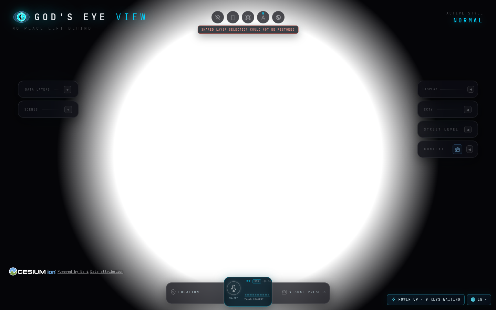
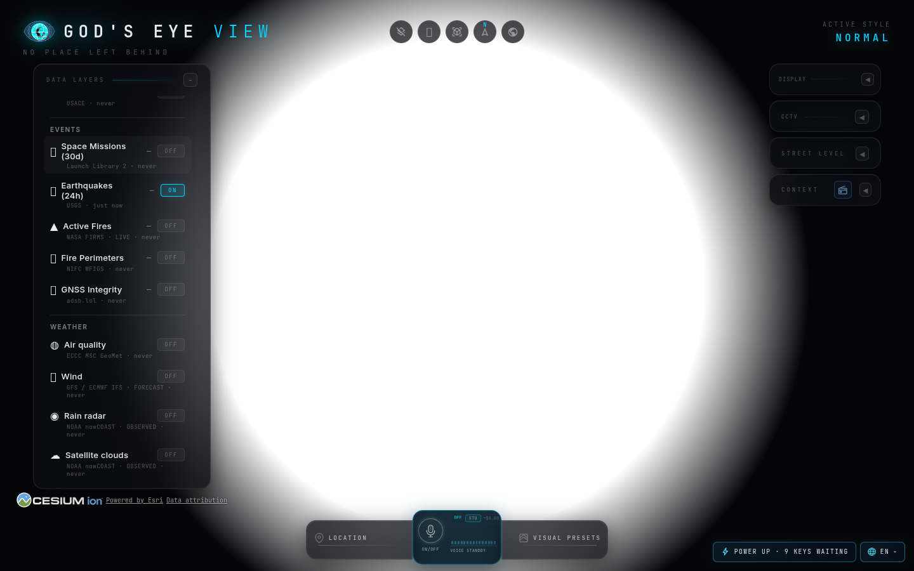
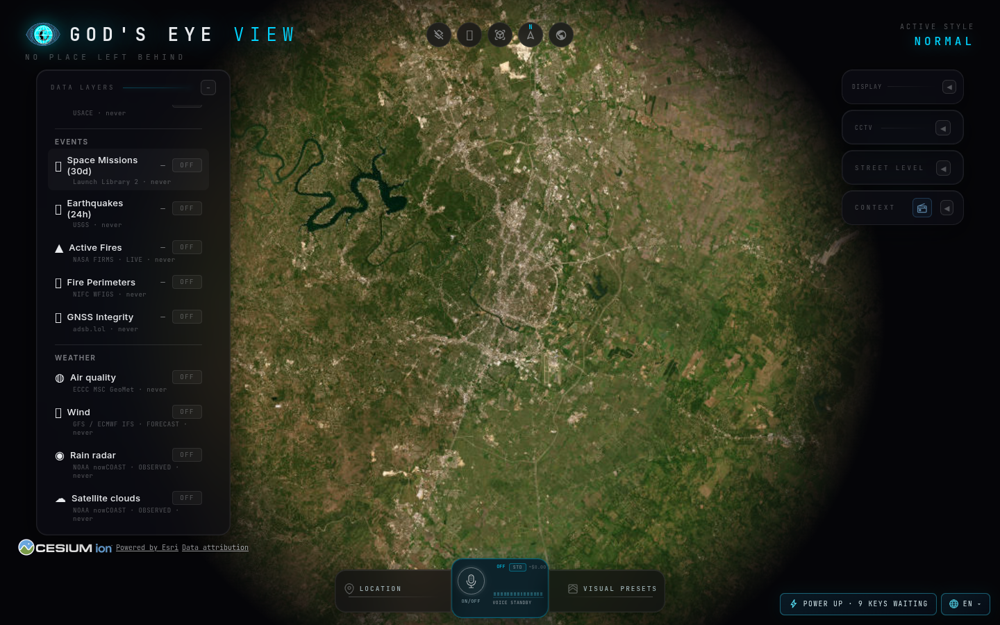

# Share-link restoration browser evidence

Existing upstream PR: [bilawalsidhu/gods-eye-view#834](https://github.com/bilawalsidhu/gods-eye-view/pull/834)

Runtime tested: `75d59cb3d86c2a53618e3bf1389f734760ac4cf7` (includes origin main `1df2a272cf7cfbb2f1a4c637c897e90719b0af95`). This evidence branch adds a reproducible QA script and captured artifacts; application runtime files are unchanged from that PR head.

## Result

**All four browser cases passed.** Chrome navigated each link in a fresh browser context. The harness observed the real startup restoration event, layer registry, layer toggle, and rendered status element. It did not call the application's restoration or notice methods or inject layer state.

| Link | Actual enabled layers | Invalid-layer notice | Result |
| --- | --- | --- | --- |
| No `l` parameter | `[]` (observed fresh-context baseline) | Absent | PASS |
| `l=unknown` | `[]`, matching the baseline | Visible | PASS |
| `l=e.unknown` | `[]`, matching the baseline; Earthquakes not partially salvaged | Visible | PASS |
| Valid link encoded by `encodeLayerStateParams`, including `l=e` | `["earthquakes"]`; Earthquakes toggle ON | Absent | PASS |

Both malformed inputs showed **“Shared layer selection could not be restored”** after startup restoration settled and the loading cover became hidden. The status element had `role="status"` and `aria-live="polite"`. Neither control produced an invalid-layer notice. The browser monitor captured zero page errors or Cesium render-loop errors.

The baseline and valid screenshots expose the Earthquakes OFF/ON state through the normal Data Layers controls. The invalid screenshots and direct status-element captures show the actual banner. Exact event timing, restored state, console messages, and request observations are in [evidence.json](evidence.json).

## Captures

These are direct screenshots of the status element, followed by the full viewport captures. The full baseline and valid captures show the Earthquakes control.

| Unknown token | Mixed valid and unknown tokens |
| --- | --- |
|  |  |

### Unknown shared layer


### Mixed valid and unknown layers



### Valid Earthquakes share



### Fresh-context baseline



## Environment and proof boundary

Recorded October 17, 2026, on Linux with Node 24.14.0, headless Chrome 152.0.7977.75, SwiftShader WebGL, and a 1440 × 900 viewport. Each case used a fresh browser context and a keyless local Vite server.

The public USGS feed was an empty `FeatureCollection`; the valid case requested it once. The local Google tiles-token bootstrap returned `{}`, and optional Google Maps and OpenAI requests were blocked. These fixtures let the normal application startup and layer lifecycle run without provider credentials. The valid link was encoded with the repository's production layer-state encoder.

The disposable browser used `QA_ACCEPT_INSECURE_CERTS=1` because this executor's public-site certificate chain failed in an earlier run. That setting is recorded in the evidence and applies only to this QA browser. Public map imagery was still loading in some captures. The result demonstrates share restoration and the visible notice; imagery readiness, live earthquake data, other locales, and other browsers were not tested by this gate.

Separately, the original runtime head's [hosted CI run 38995758564](https://github.com/bilawalsidhu/gods-eye-view/actions/runs/38995758564) passed Windows onboarding, Node 24.14.0, Node 26.x, and the Street Level browser gate. This focused browser evidence supplements those checks. Maintainer review remains required.

## Reproduce

Use runtime checkout `75d59cb3d86c2a53618e3bf1389f734760ac4cf7` and copy this branch's `scripts/qa-share-invalid-layer-notice.mjs` into its `scripts/` directory. Install the lockfile dependencies with supported Node 24.14.x or 26.x. Start the keyless dev server:

```bash
npm ci
npm run dev -- --host 127.0.0.1 --port 4175
```

In a second terminal in the same checkout, point `PUPPETEER_EXECUTABLE_PATH` at an installed Chrome executable:

```bash
QA_BASE_URL=http://127.0.0.1:4175 \
QA_EXPECTED_HEAD=75d59cb3d86c2a53618e3bf1389f734760ac4cf7 \
PUPPETEER_EXECUTABLE_PATH=/path/to/chrome \
node scripts/qa-share-invalid-layer-notice.mjs
```

The recorded executor additionally set `QA_ACCEPT_INSECURE_CERTS=1`; omit it when normal certificate verification works. The script saves fresh results under `qa-shots/share-notice/`. The evidence branch's copies are under this directory so the reviewed run remains stable.

## Credit

- daikaginza reported the unsurfaced `layerStateInvalid` result in upstream #776.
- KnottyDyes independently identified the silent whole-payload drop in the #658/#760 discussion.
- asturksever requested the documentation, formatter-scope, and shared-scheduler follow-ups.
- quanticsoul4772 supplied independent Windows and translation review.

This receipt documents the existing contribution and its observed behavior. It does not claim an upstream merge.
